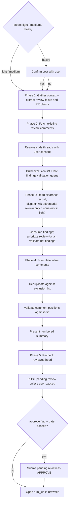

# wk-pr-review

> Thorough, adversarial code review of a GitHub PR — delegates deep investigation
> to [`wk-adversarial-review`](../adversarial-review/README.md) and posts a pending
> review for human submission.

**Version:** `2026.10.20-230936`

## Invocation

| Mode | Trigger |
|------|---------|
| User-invocable | `/wk-pr-review [light\|medium\|heavy] [approve] [PR number or URL] [focus...]` |
| Model-invocable | Automatic on: "review this PR", "review code changes", "create review comments", or "investigate a pull request" |

## Review Modes

| Mode | Scope | Time box |
|------|-------|----------|
| `light` | Diff, description, and PR claims validated; objective static review; no adversarial dispatch | a few minutes |
| `medium` (default) | light + adversarial harness that tries to break the change + thorough arch/functional review | 10–15 min |
| `heavy` | medium + runs the change (browser for UI), every local gate, full path/edge/mutation matrix | confirms first |

`heavy` always asks before starting; non-interactive callers (e.g. sitrep auto-reviews) fall back to `medium`.

## Approve Flag

Add `approve` (e.g. `/wk-pr-review medium approve 123`) to submit the review as an approval on your behalf when it has
no `concern:` comments, no blocked verdict, no open prior concern, no failing required check, and you are not the
author. Any gate miss → the review stays pending and the terminal lists why. Without `approve`, the review is always
pending. Dispatched callers never approve.

## Focus Argument

Anything after the PR (or after the last recognized token) is free-text focus, e.g.
`/wk-pr-review heavy 123 retry logic under partial network failure`. Focus items rank ahead of the author's asks and
get at least one targeted adversarial run in every mode, but the full diff is still reviewed. Each item's outcome is
reported in the terminal, never in the GitHub review body.

## How It Works

## Noteworthy

- **The review body is the verdict line plus the footer** — with or without concerns. Inline comments carry the
  substance; a pre-POST gate cuts every extra sentence that is not an un-anchored concern, a `Re:` answer, or an
  evidenced bot reply. Review depth is reported in the terminal, never on GitHub.
- **The pending-review POST is its own Bash call** — payload via the Write tool, footer gate and `open` as separate
  calls; a hook input-rewrite denial gets one retry, then a hand-off with the payload path.
- **Investigation is delegated, and never re-run:** Phase 3 consumes an existing clearance record when one covers
  this HEAD, else dispatches [`wk-adversarial-review`](../adversarial-review/README.md) once; it owns the sweep
  catalog, the fresh adversarial subagent, and all `.review-playground/` validation. pr-review consumes its findings
  and verdict rather than re-deriving them — the verdict never blocks posting, only an `approve` submission.
- **Optional reviewer systems require current-task opt-in:** existing CI-triggered output is consumed as evidence; no
  fresh optional local or external model review starts without an explicit user request.
- **HARD RULE — never submit without explicit user confirmation:** The pending review is created after the
  Phase 4 summary unless the user explicitly pauses; the user still submits it from the GitHub UI. Sole exception:
  the literal `approve` token plus a passing approve gate submits it as `APPROVE` — never `COMMENT` or
  `REQUEST_CHANGES`.
- **Bot findings are validated before reply:** Every active bot comment is routed through the adversarial engine
  and classified Confirmed, Refuted, or Inconclusive. Confirmed findings get silent skip; confirmed-but-narrower,
  confirmed-but-broader, refuted, and agent-backed inconclusive cases get replies with new evidence.
- **`in_reply_to` is invalid in draft review payloads:** The GitHub REST API rejects it with 422. Bot-thread
  replies must either be folded into the review body or posted as live replies — they cannot be embedded in the
  `comments[]` array of the pending review.
- **Author review-focus items must be answered:** Explicit questions or flagged areas in the PR description are
  captured as a `review_focus` list in Phase 1. Every item must be answered inline or in the review body before
  the review is presented — unanswered author asks are a review gap.
- **Architecture changes escalate to [`wk-arch-review`](../arch-review/README.md), once:** Phase 1 runs that
  skill's mechanical detector (design docs, new services/datastores/IaC, trust-boundary or API/contract changes,
  ownership-reshaping migrations), consumes a recorded verdict when one covers this HEAD, and dispatches only
  when none exists — folding its SPOF / unhappy-path / assumption findings in as concerns.
- **The reviewed head is pinned at POST time:** Phase 5 rechecks `headRefOid` immediately before every review
  create/recreate. A mismatch stops the POST until the delta, findings, and anchors are revalidated; `commit_id`
  then pins the payload to the investigated SHA.
