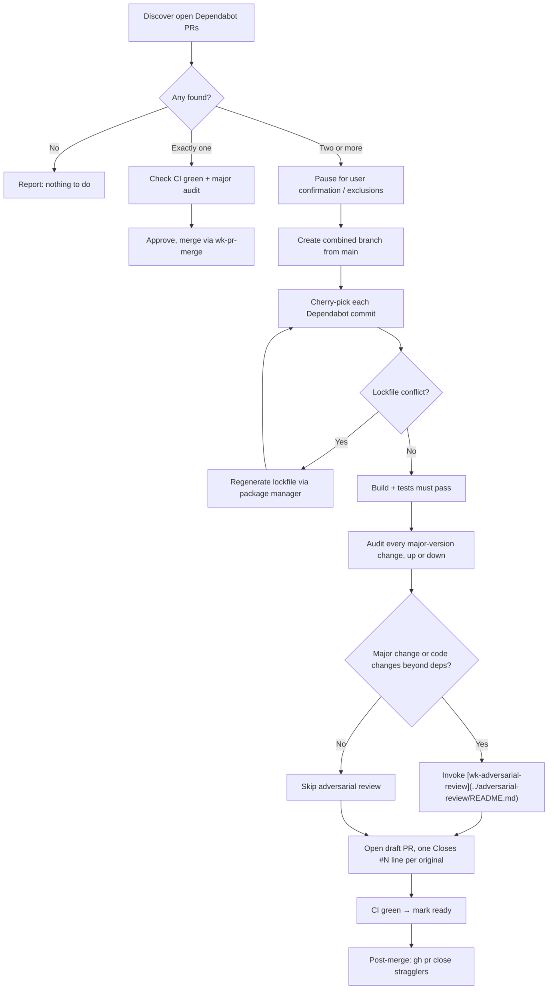

# wk-renovate

> **Version:** 2026.11.19-195405 · **Group:** pull-request · **Model:** sonnet

Land every open Dependabot PR in the current repo ("gh-deps"): a lone PR is
approved and merged once CI is green; several are batched into a single
combined dependency-update PR — one branch, one review, one merge.

## Why

Dependabot opens one PR per dependency bump. In active repos this creates a
queue of 10–30 open PRs, each needing CI, review, and merge.
[wk-renovate](../renovate/README.md) collapses them into one PR that upgrades
everything at once.

## Trigger

| How | When |
|-----|------|
| `/wk-renovate`, "gh-deps" | One open Dependabot PR → approve + merge; several → combine into one update PR |
| `/wk-renovate cleanup` | Close superseded Dependabot PRs after the combined PR merges |

## Flow

## Key Rules

- **Single PR fast path** — exactly one open Dependabot PR is approved and
  merged via [wk-pr-merge](../pr-merge/README.md) once CI is green; never
  approve red, never push onto Dependabot's branch.
- **Build, tests, and CI gate the combined PR** — red locally blocks the push;
  the PR opens as a draft and is marked ready only when CI is green.
- **`Closes #N` auto-closes PRs too** — one keyword per PR, one per line
  (`Closes #NNN, #MMM` closes only the first); Step 7 handles any stragglers.
- **Every major-version change is audited** — up or down, direct or
  transitive, found by diffing the lockfile against base; the audit covers
  default-behavior changes, and a reverted safety default is restored
  explicitly with a failing-first spec. A green suite is not evidence of safety.
- **Derived artifacts regenerate against fresh isolated state** — a throwaway,
  freshly migrated DB, scoped to the bumped packages; never the shared dev DB.
- **Adversarial review** runs when any major change exists or the diff touches
  application code beyond manifests and lockfiles.
- **Automated external review** is always skipped for dependency-only updates.
- **Lockfile conflicts** are resolved by regenerating via the detected package
  manager, not by manual conflict resolution.
- **Container env is not inherited** — a lockfile regen inside a container
  reproduces the provisioning script's registry-credential export in the same
  exec shell; a deterministic red is rerun with forwarded config-override vars
  unset before any bump takes the blame.

## Integration

- Invokes [wk-gh](../gh/README.md) for org-scoped GitHub operations.
- Invokes [wk-adversarial-review](../adversarial-review/README.md) when a major
  change or code change is detected.
- Invokes [wk-commit](../commit/README.md) for the combined commit.
- Invokes [wk-pr](../pr/README.md) for PR creation.
- Invokes [wk-pr-merge](../pr-merge/README.md) for the single-PR merge.
